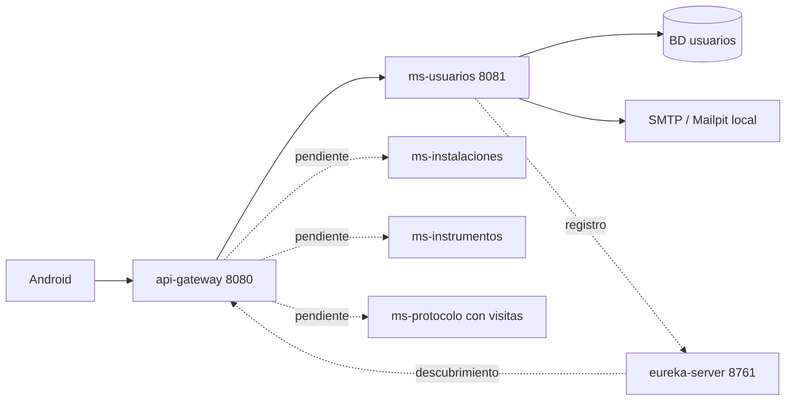

# Arquitectura del backend Induztek

La app Android administra visitas, equipos y protocolos de pruebas eléctricas. El backend debe conservar esas responsabilidades y reemplazar las operaciones locales que necesitan identidad compartida y datos del servidor. Esta entrega comienza por usuarios y autenticación, según la prioridad solicitada.

## Evidencia revisada

Se consultaron `Config final.docx` y `MS.docx` del escritorio y el código de `AppProtocolos_EQ014`, especialmente `RegistroUsuarioRepository.kt`, `RegistroViewModel.kt`, `ValidacionesRegistro.kt`, `RecuperarViewModel.kt`, `UsuarioRepository.kt`, modelos y README. No se modificó ningún archivo de Android.

`Config final.docx` exige al menos tres microservicios desacoplados con bases propias, API Gateway, Swagger y códigos HTTP precisos. `MS.docx` propone Eureka, gateway, usuarios, instalaciones, instrumentos, visitas y protocolos; también permite reunir visitas y protocolos como `ms-protocolo`. Exige que el administrador asigne roles, evidencias fotográficas y código de contraseña enviado por correo. Las indicaciones de iconos, APK, firma y llave corresponden al trabajo Android.

## Servicios identificados

| Componente | Responsabilidad y datos propios | Dependencias de negocio | Estado |
|---|---|---|---|
| `ms-usuarios` | Usuarios, roles, credenciales, respuestas con hash, códigos y sesiones | SMTP para recuperación | Implementado |
| `ms-instalaciones` | Instalaciones de clientes y equipos, TAG, datos técnicos, titularidad | Referencias a usuarios/clientes | Pendiente |
| `ms-instrumentos` | Instrumentos Induztek, identificación y vigencia de calibración | Sin dependencia directa de usuarios para sus datos | Pendiente |
| `ms-protocolo` | Visitas/OT, asignaciones, pruebas, mediciones, estados, historial, formalización, acta, recepción y referencias a evidencias | Usuarios, instalaciones/equipos e instrumentos | Pendiente |
| `api-gateway` | Entrada HTTP única y rutas hacia servicios | Eureka | Implementado |
| `eureka-server` | Registro y descubrimiento de servicios | Sin base de negocio | Implementado |

Se adopta la alternativa de reunir visitas y protocolos del documento: comparten la ejecución de la visita y su cierre. Si aumenta su tamaño o cambia su ciclo de despliegue, visitas puede extraerse después. No se han creado servicios vacíos para contarlos como funcionalidad implementada.

Cada futuro servicio tendrá su base y usuario de BD exclusivos. No habrá joins ni claves foráneas entre bases: se conservarán IDs externos y las consultas pasarán por APIs. Las tablas y migraciones incluidas ahora pertenecen solo a usuarios.

## Decisiones de esta entrega

**Registro sin privilegios.** Android ya solicita nombre, RUT, teléfono, correo personal, pregunta y respuesta. El servidor genera un correo interno único y deja `rolCodigo=null`, `activo=false` y `passwordHash=null`. El identificador interno usa inicial/apellido y cuerpo del RUT para resolver colisiones sin depender de conteos concurrentes. No se aprovisiona un buzón real con ese identificador; los mensajes se envían al correo personal.

**Asignación por ADMIN.** `ADMIN` es un rol nuevo y explícito, separado de `JEFE_TECNICO`. Los demás roles mantienen los códigos Android. Asignar un rol habilita la cuenta, pero no genera ni devuelve contraseñas. El usuario configura su primera clave con el mismo flujo de código que usa para recuperarla. Esto permite respetar el formulario preparado sin enviar claves temporales en claro. El administrador debe comunicar la habilitación; no hay notificación automática de aprobación en esta etapa.

**Credenciales y sesiones.** PBKDF2-HMAC-SHA256 con sal aleatoria de 16 bytes, 310 000 iteraciones y clave derivada de 256 bits, usando los valores predeterminados de Spring Security 5.8. La sal queda incluida en el valor codificado. La respuesta se normaliza en espacios y mayúsculas antes del hash. No se devuelven hashes, sales, respuestas ni códigos en las APIs. Los tokens Bearer son opacos, aleatorios de 256 bits y caducan a las 12 horas; solo se guarda SHA-256 del token. No son JWT. Cada petición consulta la sesión y el estado actual en usuarios. Logout, recuperación, cambio de rol o desactivación revocan sesiones en el servidor.

**Recuperación.** La pregunta y respuesta verificadas habilitan el envío de un código de ocho dígitos al correo personal guardado. El código queda protegido con HMAC-SHA256 y un secreto de entorno, ligado al usuario. Caduca en diez minutos, admite cinco errores y se consume una sola vez. Se bloquea la fila de usuario para serializar operaciones concurrentes. Los intentos errados se confirman en BD aunque la respuesta sea 400. Un reenvío, con espera mínima de sesenta segundos, reemplaza el código anterior. Si SMTP falla, se revierte el nuevo código y se devuelve 503.

**Errores y abuso.** Validación de JSON y campos, RUT módulo 11, celular chileno, preguntas permitidas y unicidad en BD. Respuestas JSON consistentes. La solicitud de recuperación devuelve el mismo 202 para datos incorrectos y cuentas pendientes, inactivas o inexistentes; un fallo de SMTP produce 503 y puede revelar una diferencia de disponibilidad. Se limita login a diez peticiones por correo cada quince minutos, recuperación a cinco y restablecimiento a diez. Registro tiene cinco por correo cada quince minutos y los POST de autenticación sesenta por IP directa por minuto. Estos límites adicionales son locales a la instancia y se reinician al reiniciar; en varias réplicas deben moverse a Redis/ingress. El límite persistente de errores del código sí se comparte mediante la BD.

**Despliegue.** Flyway controla esquema; H2 es desarrollo y PostgreSQL la opción Compose. Los servicios son procesos separados. Eureka/SMTP se mantienen dentro de la red de desarrollo o red privada. Para exposición externa faltan el entorno de HTTPS, secretos administrados y validación operativa. Con proxy, usuarios cuenta la IP del gateway; cualquier límite por IP real debe configurarse en un ingress que controle las cabeceras.

## Próximas etapas

1. Conectar Android a este contrato desde su otro chat, incluyendo errores de campo, el rol ADMIN y la pantalla de código.
2. Implementar instalaciones/equipos y su autorización por cliente.
3. Implementar instrumentos con calibración y validaciones.
4. Implementar visitas/protocolos: asignación por ingeniero o jefe, formulario por pasos, estados, evidencias, mediciones, historial, acta y formalización.
5. Definir validación de identidad para los futuros servicios: introspección interna autenticada o tokens firmados con verificación y revocación coordinadas. No deben compartir acceso SQL a la BD de usuarios.

Los cuatro servicios de negocio previstos satisfarán el mínimo de tres cuando estén implementados; esta entrega implementa uno. Las diez pruebas sobre archivos Android y el empaquetado de la app siguen siendo responsabilidad de la entrega Android.
